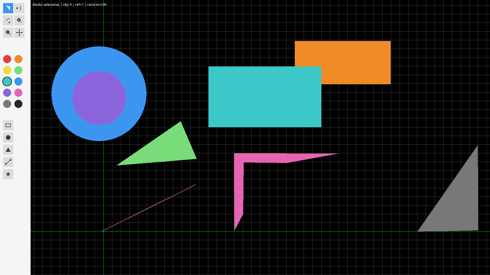
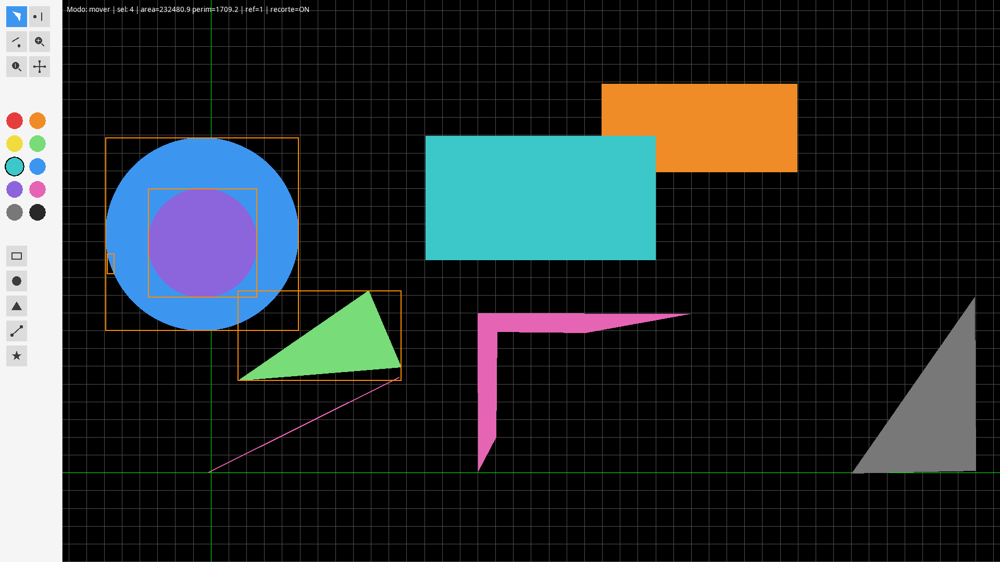
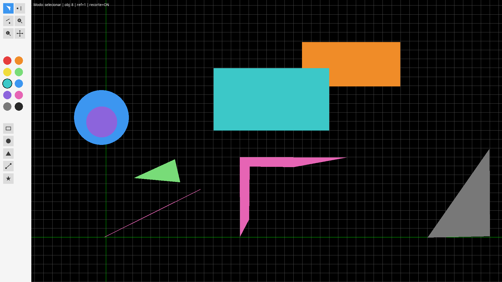
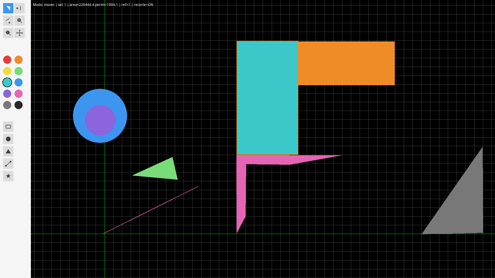

# Editor 2D Interativo — Computação Gráfica

Trabalho acadêmico desenvolvido para a disciplina de **Computação Gráfica** do **6º período de Ciência da Computação**. O projeto consiste em um **ambiente interativo 2D** que permite ao usuário **construir, selecionar e manipular** objetos gráficos em tempo real, com **transformações geométricas representadas por matrizes homogêneas 3×3**, além de **sistema de coordenadas window ↔ viewport**, **recorte** de primitivas e recursos de **visualização** (zoom e pan).

O editor suporta a criação de **polígonos** (convexos e não convexos), **retângulos**, **triângulos**, **círculos** e **segmentos de reta**, todos tratados como objetos independentes que guardam seus pontos em um **sistema de coordenadas próprio** (local) e uma **matriz de transformação acumulada** que começa na identidade. A partir de interações com o mouse e o teclado, o usuário pode transladar, rotacionar e escalar esses objetos — sempre por meio de **composição de matrizes**, nunca editando coordenadas ponto a ponto. O editor também permite **consultar propriedades** (área e perímetro) dos objetos selecionados, alterar a **cor** e o **preenchimento**, e **remover** objetos da cena.

A interface foi dividida em duas áreas: a **cena** (onde os objetos vivem) e uma **barra lateral de ferramentas** (sidebar), com paleta de cores e botões para criação e manipulação dos objetos. A dinâmica de inserção foi pensada para ser intuitiva: o usuário clica na ferramenta desejada e, em seguida, no local da cena onde deseja inserir o objeto. Formas como retângulo, triângulo, círculo e segmento usam **múltiplos cliques** para definir seus vértices ou parâmetros (por exemplo, o círculo é definido pelo centro e por um ponto na borda, cuja distância define o raio).

---

## Conteúdo teórico abordado

O projeto exercita, na prática, os principais conceitos da pipeline gráfica 2D:

- **Coordenadas homogêneas**: pontos 2D `(x, y)` são representados como vetores `[x, y, 1]ᵀ`, permitindo que translação, rotação e escala sejam todas expressas como multiplicação de matrizes **3×3**.
- **Transformações afins**: translação, rotação (em torno da origem e em torno de um ponto arbitrário `p`, via `T(p) · M · T(−p)`) e escala (uniforme e não uniforme).
- **Composição de matrizes e não comutatividade**: a ordem em que as transformações são compostas altera o resultado — `T · R ≠ R · T`. O projeto adota a convenção `M ← nova · M` (a transformação mais recente entra à esquerda e age por último, no referencial do mundo), coerente com o scaffold fornecido.
- **Sistemas de coordenadas**: separação entre o **mundo** (onde os objetos vivem) e a **tela** (pixels), com uma matriz **window → viewport** que mapeia um retângulo do mundo para o retângulo de pixels da janela. Zoom e pan alteram o **estado da câmera**, sem tocar nas coordenadas dos objetos.
- **Seleção (picking)**: teste "o ponto caiu dentro?" — **ray casting** para polígonos e **distância ao centro** para círculos.
- **Recorte (clipping)**: **Cohen-Sutherland** para segmentos de reta e **Sutherland-Hodgman** para polígonos, com janela de recorte definida em coordenadas do mundo.
- **Propriedades geométricas**: fórmula do **cadarço (shoelace)** para área de polígonos, soma de arestas para perímetro, e fórmulas diretas para círculos.

---

## Tecnologias utilizadas

O projeto foi desenvolvido em **Python 3** e utiliza a biblioteca **Pyglet** para criação da janela, renderização de formas primitivas (`shapes.Polygon`, `shapes.Line`, `shapes.Circle`, `shapes.Rectangle`, etc.) e captura de eventos de mouse e teclado. A biblioteca **NumPy** é usada para as operações matriciais (matrizes 3×3 e multiplicação vetorizada dos pontos). Não foram utilizados shaders nem pipelines de GPU — todo o processamento geométrico é feito em CPU, e as primitivas são desenhadas com as shapes padrão do Pyglet.

**Requisitos**:

- Python 3.10 ou superior
- `pyglet >= 2.0`
- `numpy`

---

## Como rodar

### 1. Clone o repositório


git clone <url-do-repositorio>
cd <pasta-do-projeto>

### 2. Crie e ative um ambiente virtual

python3 -m venv .venv
source .venv/bin/activate          # Linux / macOS
.venv\Scripts\activate             # Windows (PowerShell)

### 3. Instale as dependências

pip install -r requirements.txt

### 4. Execute o editor

python editor2d.py

## Estrutura do projeto
.
├── editor2d.py       # orquestrador do editor (lógica, câmera, renderização, eventos)
├── abaRecursos.py    # barra lateral de ferramentas (sidebar)
└── requirements.txt

### editor2d.py - orquestrador do editor

O editor2d.py concentra a lógica central do editor e foi organizado em 13 blocos com responsabilidades bem definidas. Os blocos cobrem, em ordem: criação da janela e batches; matrizes homogêneas 3×3; câmera (window ↔ viewport); utilitários de geometria; algoritmos de recorte (Cohen-Sutherland e Sutherland-Hodgman); a classe Objeto2D; estado global; renderização (objetos, grade, HUD, previews, bbox); manipulação dos selecionados; funções de criação; eventos de mouse; eventos de teclado; e o on_draw com o ponto de entrada. Essa divisão facilita a leitura e a manutenção, permitindo localizar rapidamente qualquer responsabilidade.

### abaRecursos.py - barra lateral de ferramentas

O abaRecursos.py implementa a barra lateral de ferramentas, desenhada em pixels e dividida em três seções: manipulação (selecionar, girar, aumentar, diminuir, transladar), paleta de cores (dez opções circulares) e criação (retângulo, círculo, triângulo, segmento e polígono). O módulo não conhece o editor: apenas detecta cliques e devolve um evento (ex.: ("ferramenta", "retangulo")), interpretado pelo editor2d.py. Isso evita dependência circular e mantém cada arquivo com uma responsabilidade única — o abaRecursos.py cuida da interface, e o editor2d.py cuida da lógica.

### Controles

| Categoria | Ação | Tecla / mouse |
|---|---|---|
| **Modos** | Entrar no modo selecionar | `S` |
| **Modos** | Entrar no modo mover | `M` |
| **Seleção** | Selecionar objeto | clique sobre o objeto |
| **Seleção** | Adicionar à seleção | **Shift + clique** |
| **Seleção** | Selecionar por laço | arrastar no vazio |
| **Criação** | Criar polígono | `P` + cliques + `Enter` |
| **Criação** | Criar círculo | `C` |
| **Criação** | Criar triângulo | `T` |
| **Criação** | Criar retângulo | `R` |
| **Criação** | Criar segmento | `L` + dois cliques |
| **Criação** | Criar pela sidebar | clique na ferramenta → clique no mundo |
| **Criação** | Cancelar criação | `Esc` |
| **Transformação** | Transladar | setas `← → ↑ ↓` |
| **Transformação** | Rotacionar | `Q` / `E` |
| **Transformação** | Escalar | `+` / `−` |
| **Transformação** | Escala não uniforme | `Shift + X` / `Shift + Y` |
| **Transformação** | Ponto de referência | `1` centro · `2` canto do bbox · `3` ponto clicado |
| **Aparência** | Alterar cor | `H` |
| **Aparência** | Alternar preenchimento ↔ contorno | `G` |
| **Aparência** | Consultar área/perímetro | `I` |
| **Aparência** | Remover selecionados | `Del` |
| **Câmera** | Zoom in / out | scroll do mouse |
| **Câmera** | Pan | botão do meio + arrastar |
| **Câmera** | Ligar/desligar recorte | `F1` |
| **Geral** | Sair do editor | `Esc` |

## Exemplos

## Exemplos

**Figura 1 — Editor com a barra lateral e objetos criados**



**Figura 2 — Polígono selecionado**



**Figura 3 — Polígonos transladado e escalonado**



**Figura 4 — Polígono rotacionado**




---


### Autores

```markdown
## Autores

- **[Eliézer da Silva]** — [eliezedasilva2005@gmail.com]

